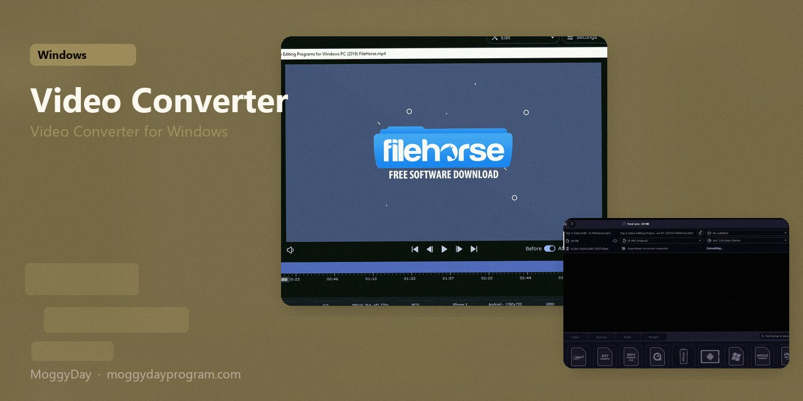
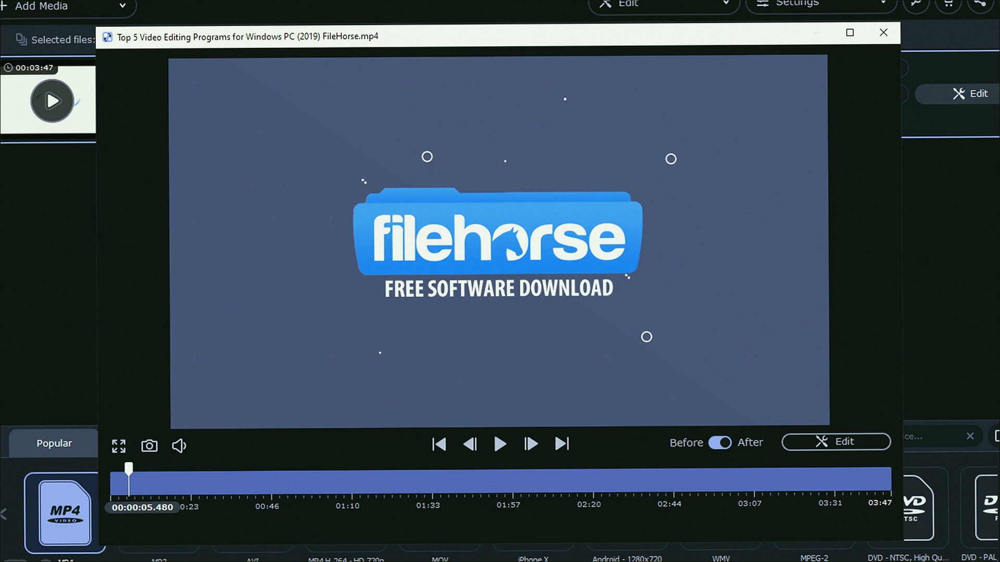
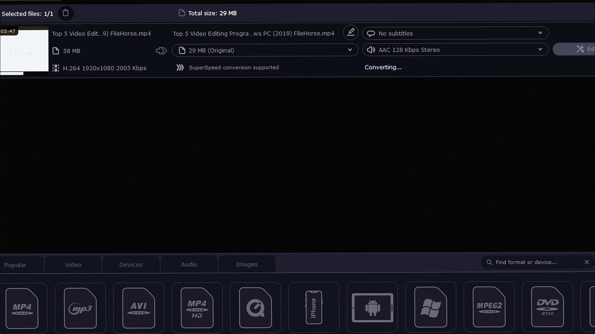
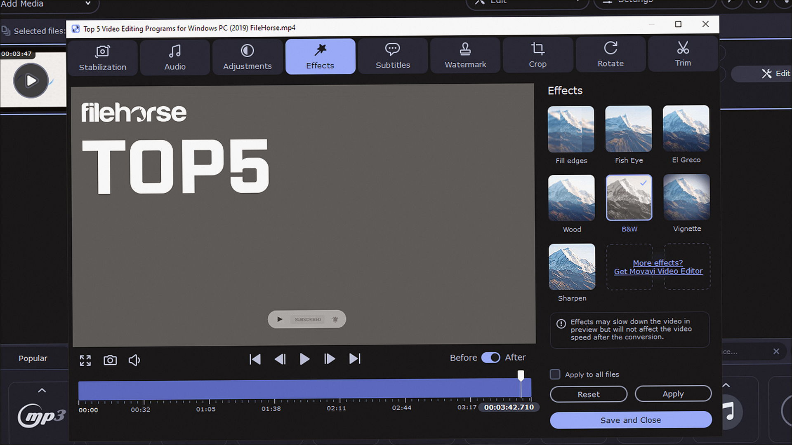

# Movavi Video Converter 24.5

Video Converter for Windows. Movavi Video Converter on Windows 10/11 x64. 145 MB. Requirements, screenshots, MoggyDay Launcher.

[Pages](https://cavernwithinshow.github.io/movavi-video-converter-windows/) · [RU](https://moggydayprogram.com/programs/movavi-video-converter) · [EN](https://moggydayprogram.com/en/programs/movavi-video-converter)

  

  
  
  

1. Open the RU or EN card on moggydayprogram.com
2. Press **Download** on that card. The file is only on moggydayprogram.com — not in this repo.

Category: [Video catalog](https://moggydayprogram.com/categories/video)

- [Movavi Video Suite](https://moggydayprogram.com/programs/movavi-video-suite)
- [Movavi Video Editor](https://moggydayprogram.com/programs/movavi-video-editor)

No installer in this git repo.
